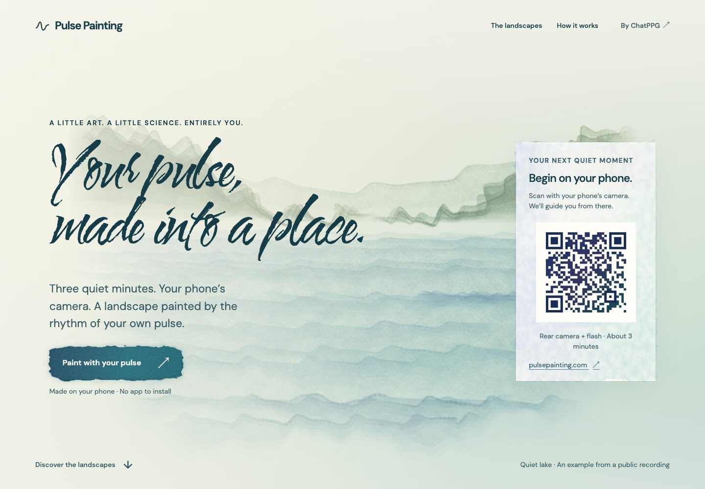
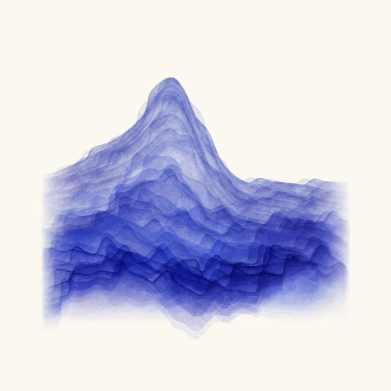
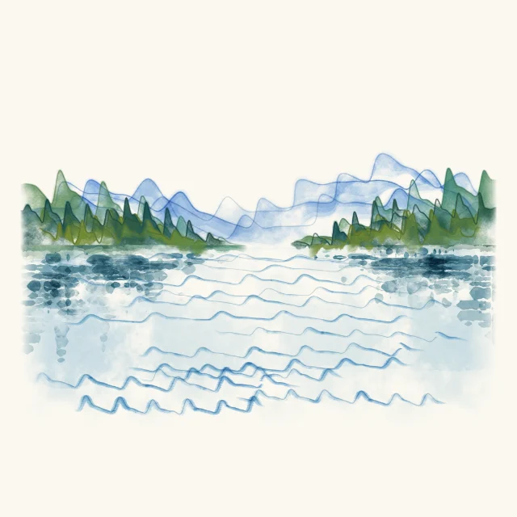
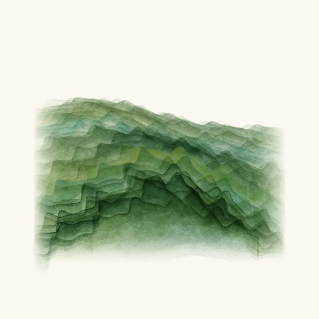
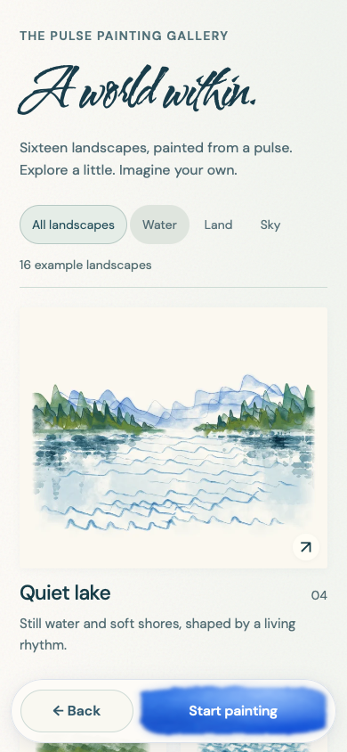
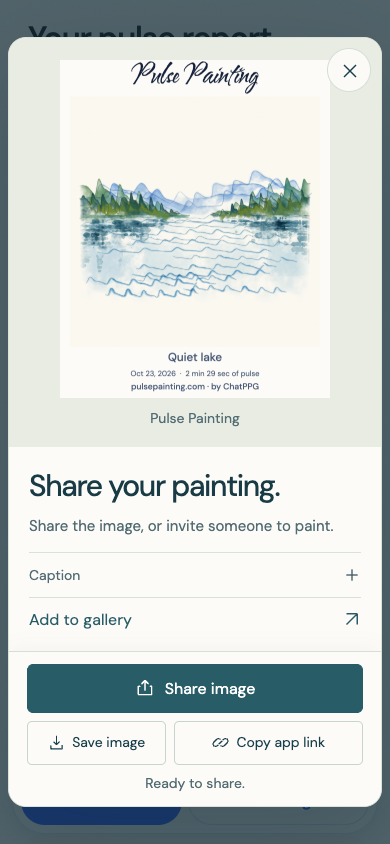

# Pulse Painting

Your pulse, made into a place.

> Live at [pulsepainting.com](https://www.pulsepainting.com/): sixteen pulse-derived
> watercolor landscapes, crisp measured pulse strokes, a pointed brush and soft
> trailing pigment, a calm zoom-out reveal, and shareable artwork.
> Browser replay and deployed-asset checks passed; physical-phone validation remains separate.
> See [current release verification](docs/validation/slow-phone-2026-10-23.md).
> The [mobile gallery](https://www.pulsepainting.com/#landscapes) is now live too;
> see [mobile verification](docs/validation/mobile-gallery-2026-10-23.md).
> Community publishing and artwork sharing are live;
> see [sharing release checks](docs/validation/community-sharing-2026-10-23.md).
> Existing sketchbook links remain supported; see [recipient-page checks](docs/validation/shareable-sketchbooks-2026-10-23.md).

Pulse Painting is a three-minute phone-camera capture experience by [ChatPPG](https://chatppg.com), powered by [ppg-js](https://github.com/sontakey/ppg-js). Accepted pulse waveforms paint one of sixteen landscapes, with layered watercolor washes and recognizable pulse contours. A close-up follows the brush during capture, then pulls back to reveal the same painting, ready to share alongside an expandable HRV report.

<p align="center">
  
  
  
</p>

The capture screenshot shows the compact LIVE/signal header and crisp pulse brush with forty seconds of the public recording preloaded through the actual app. The report image documents the earlier foreground release. Both use mocked camera input; see [capture provenance](docs/media/README.md). They are not physical-phone measurements or session benchmarks.

The primary destination is [pulsepainting.com](https://www.pulsepainting.com/), a separate Vercel project connected to this repository. The apex domain redirects to www. The simple library demo remains at [ChatPPG](https://chatppg.com/ppg-js-demo). Release and public verification status are tracked in [HANDOFF.md](HANDOFF.md).

## Desktop gallery

The desktop experience opens with a full-screen landscape, a painted invitation
to begin on your phone, and a gallery of all sixteen scene families. Browse
water, land and sky, open an artwork at full size, then share its labeled example
image or copy a link. Keyboard navigation, reduced motion and a stationary QR
keep the gallery and phone handoff accessible. A three-illustration watercolor
walkthrough explains fingertip placement, painting and keeping the artwork.
These [editorial illustrations](docs/design/how-it-works-illustrations.md) load
only near the desktop walkthrough; they are not generated from a recording.



**Desktop experience.** Direct browser capture from the earlier foreground
release. See [image provenance](docs/media/README.md).

<p align="center">
  
  
  
</p>

**Alpine peaks · Quiet lake · Rolling hills.** These examples are made by the
actual app renderer from one already-public pulse recording. They show the
released renderer, combining the accepted natural pigment texture with distinct
landscape shapes. They are not visitor submissions. Your recording stays in your
browser, and sharing happens only when you choose it.

The [desktop design note](docs/design/desktop-gallery.md) records the inspected
Mobbin references, gallery behavior and validation scope. The
[gallery manifest](app/assets/gallery/manifest.json) records renderer, fixture,
signal-engine, accepted-window adapter and image hashes. All sixteen examples
are regenerated from the current renderer. Default mobile capture
does not download gallery imagery.

## Mobile gallery

Tap **Explore the paintings** on the phone's opening screen to browse the same
sixteen examples. A featured Quiet lake leads into a two-column collection;
filter by Water, Land or Sky, then open an artwork and swipe between scenes.
The floating **Back** and **Start painting** controls keep capture within reach.
Start uses the existing capture button and camera-permission flow.

<p align="center">
  
</p>

**Mobile gallery, now live.** Direct WebKit browser capture at 390 × 844 from
the tested build. The public site passed the same mobile suite; this image is
not a physical-phone test. See [image provenance](docs/media/README.md), the
[mobile design note](docs/design/mobile-gallery.md), and
[browser verification](docs/validation/mobile-gallery-2026-10-23.md).
[HANDOFF.md](HANDOFF.md) records deployment status.

The default phone screen downloads no gallery manifest or artwork until you
choose Explore; shared scene links also open the collection. Thumbnails load
lazily. Browser Back closes the artwork, then returns to the capture instructions.
These remain labeled public-fixture examples, not uploads from other visitors.

## Share a painting, or give it a public page

**Share artwork** opens a large paper-toned painting preview with a primary
**Share image** action, **Save image**, and **Copy painting link** (or
**Copy app link** while private). Native sharing hands the prepared image to
the phone, where the visitor chooses an app; unsupported browsers can save it.
An optional caption and **Add to gallery** stay separate from these actions.
Nothing posts or uploads automatically.

Publishing to **Community** is optional. Review a fresh public preview, choose
an optional display name and optional summary measurements, then explicitly
publish. Measurements start off. Raw recordings, session timestamps and renderer
seeds are not uploaded. A private removal link lets the maker withdraw their
painting; public links contain no removal key. Clearly labeled public-recording examples fill unused Community spaces until
eight real paintings are available. Actual publications appear first; the
complete sixteen-scene example collection remains available separately.

<p align="center">
  
</p>

Direct browser capture of the actual report-sharing interface, using a Quiet Lake
painting rendered from the public replay fixture; see [image provenance](docs/media/README.md).

Previously shared `/book/<painting-id>` links still open their published painting
with the adapted page-turn renderer. The main sharing flow now uses the painting
itself. The exact ThreeUI reference and its asset hashes remain preserved; see
[source provenance](vendor/threeui-sketchbook/PROVENANCE.json). Removing a
publication disables its public painting and existing sketchbook links together.

Community persistence uses server-only Neon and Vercel Blob integrations.
[Operations, privacy, migration and moderation](db/README.md) are documented
separately from the static capture runtime. [HANDOFF.md](HANDOFF.md) records
deployment status.

## Run locally

Use Node.js 24 or later:

```sh
npm ci
npm run dev
```

Open `http://127.0.0.1:5173`. `npm run build` creates a complete static site in `dist/`. Actual capture needs a compatible phone, camera and flash permissions, and HTTPS or another secure context. Desktop visitors can browse the example gallery and use the painted QR invitation to open the hosted app on their phone. Phone visitors can open the same collection with **Explore the paintings** before starting capture.

For the persistent gallery locally, use an isolated database branch and the
server-only variables in [db/README.md](db/README.md), then run
`node --env-file=.env.community.local tools/serve.mjs`. The static capture,
private export and example gallery work without these credentials.

## What is implemented

- Sixteen seeded landscape families made from accepted waveform paths, with curved terrain, flowing brush strokes and within-stroke gradients. Artistic mapping preserves the original samples; the original manuscript and computed report remain unchanged.
- During capture, a fine pulse contour follows the recording's actual time and value on a steady baseline. A pointed brush and textured wet pigment trail sit above the quieter landscape; each completed trace settles into its scenic placement. This treatment applies to all sixteen families.
- Density based on usable recorded time: sparse sessions keep open paper; longer sessions fill interleaved slots without moving earlier strokes.
- A close-up artwork camera and a continuous zoom-out reveal of the same accumulated painting. Cached layers keep the main thread available for capture.
- Optional WebGPU/WebGL2 painted entry transitions and an independent Canvas2D landscape compositor.
- Placement coaching, a small live finger preview, real-time pulse/RMSSD/SDNN, and floating mobile controls.
- Report charts, a 1080 × 1350 shareable artwork, native file sharing with download fallback, and optional metrics on the artwork.
- A full-screen desktop introduction and an on-demand mobile collection of sixteen public-fixture examples, with filters, swipe and keyboard navigation, user-initiated image sharing and scene deep links.
- An artwork-first social share screen and optional public community gallery, with reviewed image/metrics consent, personal preview links, removal and reporting.
- Simple image and link sharing, with compatible recipient pages for existing sketchbook links. The exact ThreeUI reference remains preserved separately.
- Accessible supporting typography, one brush heading per screen, reduced motion, interruption recovery, and no recording credit for stale frames.

The [landscape design contract](docs/design/pulse-painting-design.md) covers the sixteen families, data fidelity, density and recovery. Scene choice is random within an art-directed plan, not a health classification. The [mapping brief](docs/design/biometric-scene-mapping.md) distinguishes implemented source/quality/density mappings from future optional self-report ideas. The original manuscript remains available in the report menu.

No accepted pulse means retry guidance, not fabricated art. A short valid recording can produce a sparse painting even when HRV metrics are unavailable. Shared PNGs exclude raw data and session identifiers, with summary metrics included only when requested.

## Library boundary

This repository owns the art experience. [ppg-js](https://github.com/sontakey/ppg-js) owns camera acquisition, signal processing, quality gates, and computed measurements. Scientific source code is not copied here.

The temporary pinned browser artifact in [`vendor/ppg-js/0.3.1`](vendor/ppg-js/0.3.1) comes from ppg-js commit `732e1ef51f76bce9145bb7f666f92a30be5e0181`. Its [provenance manifest](vendor/ppg-js/0.3.1/PROVENANCE.json) records its SHA-256 and origin; every build verifies that checksum. The artifact includes the tested camera lifecycle fixes that npm `0.3.0` lacks. Version `0.3.1` has **not been published to npm**; publication was intentionally left pending. Replace this temporary artifact with a tested npm dependency once that release is actually available, then rerun capture, interruption, and export checks. Do not silently downgrade it.

## Verification

```sh
npm test
npm run test:safari-session
npm run test:paint-performance
npm run test:qr
npm run test:gallery
npm run test:mobile-gallery
npm run test:community-api
npm run test:community-sharing
npm run test:share-sheet
npm run test:sketchbook
npm run test:personal-sketchbook
npm run test:public-painting-page
npm run test:sketchbook-links
npm run test:public-sketchbook
```

`npm test` covers actual app callbacks, accepted-data attribution, metrics, report glyph bounds, mobile layouts, export/share behavior, compositor fallback, and both gallery suites. Gallery checks require current renderer/image provenance and exercise all sixteen scenes, keyboard focus, sharing fallbacks, mobile deep links and failure recovery in Chromium and WebKit. The mobile gallery suite additionally checks on-demand loading, 320/390/430 px layouts, filters, synthetic touch swipes, browser history, floating controls, retry, and delayed requests during the real Start/cancel flow with mocked camera acquisition. The full session test runs real-time public-recording replay in WebKit with three interruptions and automatic completion. These checks mock camera input and sharing APIs; they do not establish physical iPhone camera, thermal, or native-share performance.

The QR suite uses Python OpenCV, Pillow, and NumPy for bounded image perturbations; the static QR itself ships no encoder dependency. Optional `PPG_PYTHON` selects a prepared Python environment. Test artifacts stay in ignored `.dream-loop/`.

## Source map

- `app/`: ready, placement, capture, report, export, local fonts, and static QR assets.
- `app/landscape.js`: scene planning, accepted-source coverage, pigment rendering and the live artwork camera.
- `app/portrait.js`: same-scene export and native sharing with download fallback.
- `app/share-sheet.js` and `app/community.js`: private sharing, optional publication, public browsing, removal and reporting.
- `api/` and `server/`: persistent community endpoints, script-free painting pages and public sketchbook pages; `db/` records schema and operator procedures.
- `app/public-sketchbook.js` and `app/public-sketchbook.css`: standalone recipient book, public-image validation, native link sharing and copy fallback.
- `src/sketchbook-entry.tsx`, `src/pulse-sketchbook-document.js` and `src/pulse-sketchbook-spreads.js`: lazy personal book adaptation and local image composition; the exact ThreeUI reference is preserved in `vendor/threeui-sketchbook/`.
- `app/gallery.js` and `app/gallery.css`: desktop introduction, on-demand mobile collection, public-example browsing and sharing; the existing capture lifecycle remains separate.
- `app/assets/gallery/`: generated example thumbnails, full artworks, labeled share images and their provenance manifest.
- `src/paint-gpu.js`: optional Three.js entry compositor source.
- `tools/prepare-dist.mjs`: verify the pinned library and assemble the static app.
- `tools/generate-gallery.mjs`: regenerate the sixteen examples from the actual renderer and public fixture after a renderer change.
- `tools/serve.mjs`: local static preview and optional real community API.
- `test/e2e/`: browser replay, graph, accessibility, export, interruption, and QR checks.
- `docs/capture-and-artwork.md`: capture, rendering, and report behavior.
- `vendor/`: an immutable library artifact with its original MIT license and provenance.

Pulse Painting retains the MIT license of the original ppg-js application. Bundled fonts retain their SIL OFL licenses, and Three.js retains its MIT license. Signal quality controls pigment definition; the artwork does not interpret health or personality.
