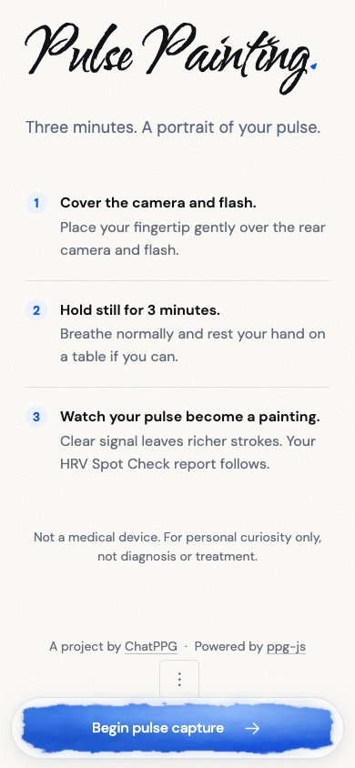
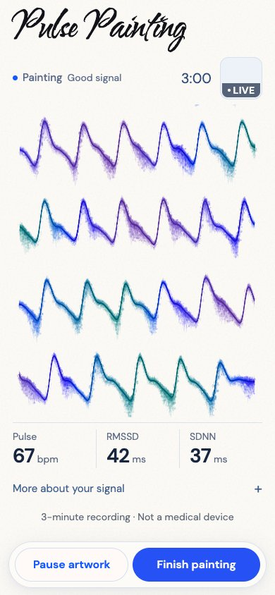
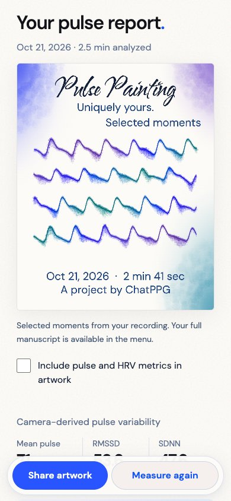

# Pulse Painting

Your pulse becomes a painting.

Pulse Painting is a three-minute phone-camera capture experience by [ChatPPG](https://chatppg.com), powered by [ppg-js](https://github.com/sontakey/ppg-js). Accepted pulse waveforms become defined watercolor strokes with organic cobalt, iris, and teal gradients, then a shareable artwork and an expandable HRV report.

<p align="center">
  
  
  
</p>

The screenshots use browser replay with mocked camera input; see [capture provenance](docs/media/README.md). They are not new physical-phone measurements.

The ChatPPG deployment route is [`/pulse-painting`](https://chatppg.com/pulse-painting), separate from the library demo at [`/ppg-js-demo`](https://chatppg.com/ppg-js-demo). The planned dedicated domain, `pulsepainting.com`, is not connected by this repository. Deployment status is tracked in [HANDOFF.md](HANDOFF.md).

## Run locally

Use Node.js 24 or later:

```sh
npm ci
npm run dev
```

Open `http://127.0.0.1:5173`. `npm run build` creates a complete static site in `dist/`. Actual capture needs a compatible phone, camera and flash permissions, and HTTPS or another secure context. Desktop visitors see a painted QR invitation to open the hosted app on their phone.

## What is implemented

- Accepted waveform strokes, within-stroke gradients, smooth manuscript scrolling, and optional WebGPU/WebGL2 composition with Canvas2D fallback.
- Placement coaching, a small live finger preview, real-time pulse/RMSSD/SDNN, and floating mobile controls.
- Report charts, a 1080 × 1350 shareable artwork, native file sharing with download fallback, and optional metrics on the artwork.
- Accessible supporting typography, one brush heading per screen, reduced motion, interruption recovery, and no recording credit for stale frames.

The proposed landscape scenes and close-up-to-landscape zoom reveal are [design work](docs/design/pulse-painting-design.md), **not implemented features**. The [mapping brief](docs/design/biometric-scene-mapping.md) describes planned use of session data and optional self-report without claiming health or emotion detection. The shipped artwork remains the pulse manuscript and selected-moment portrait.

## Library boundary

This repository owns the art experience. [ppg-js](https://github.com/sontakey/ppg-js) owns camera acquisition, signal processing, quality gates, and computed measurements. Scientific source code is not copied here.

The temporary pinned browser artifact in [`vendor/ppg-js/0.3.1`](vendor/ppg-js/0.3.1) comes from ppg-js commit `732e1ef51f76bce9145bb7f666f92a30be5e0181`. Its [provenance manifest](vendor/ppg-js/0.3.1/PROVENANCE.json) records its SHA-256 and origin; every build verifies that checksum. The artifact includes the tested camera lifecycle fixes that npm `0.3.0` lacks. Version `0.3.1` has **not been published to npm**; publication was intentionally left pending. Replace this temporary artifact with a tested npm dependency once that release is actually available, then rerun capture, interruption, and export checks. Do not silently downgrade it.

## Verification

```sh
npm test
npm run test:safari-session
npm run test:paint-performance
npm run test:qr
```

`npm test` covers actual app callbacks, accepted-data attribution, metrics, report glyph bounds, mobile layouts, export/share behavior, and compositor fallback. The full session test runs real-time public-recording replay in WebKit with three interruptions and automatic completion. These checks mock camera input and do not establish physical iPhone camera, thermal, or native-share performance.

The QR suite uses Python OpenCV, Pillow, and NumPy for bounded image perturbations; the static QR itself ships no encoder dependency. Optional `PPG_PYTHON` selects a prepared Python environment. Test artifacts stay in ignored `.dream-loop/`.

## Source map

- `app/`: ready, placement, capture, report, export, local fonts, and static QR assets.
- `src/paint-gpu.js`: optional Three.js compositor source.
- `tools/prepare-dist.mjs`: verify the pinned library and assemble the static app.
- `tools/serve.mjs`: local static preview.
- `test/e2e/`: browser replay, graph, accessibility, export, interruption, and QR checks.
- `docs/capture-and-artwork.md`: capture, rendering, and report behavior.
- `vendor/`: an immutable library artifact with its original MIT license and provenance.

Pulse Painting retains the MIT license of the original ppg-js application. Bundled fonts retain their SIL OFL licenses, and Three.js retains its MIT license. Signal quality controls pigment definition; the artwork does not interpret health or personality.
