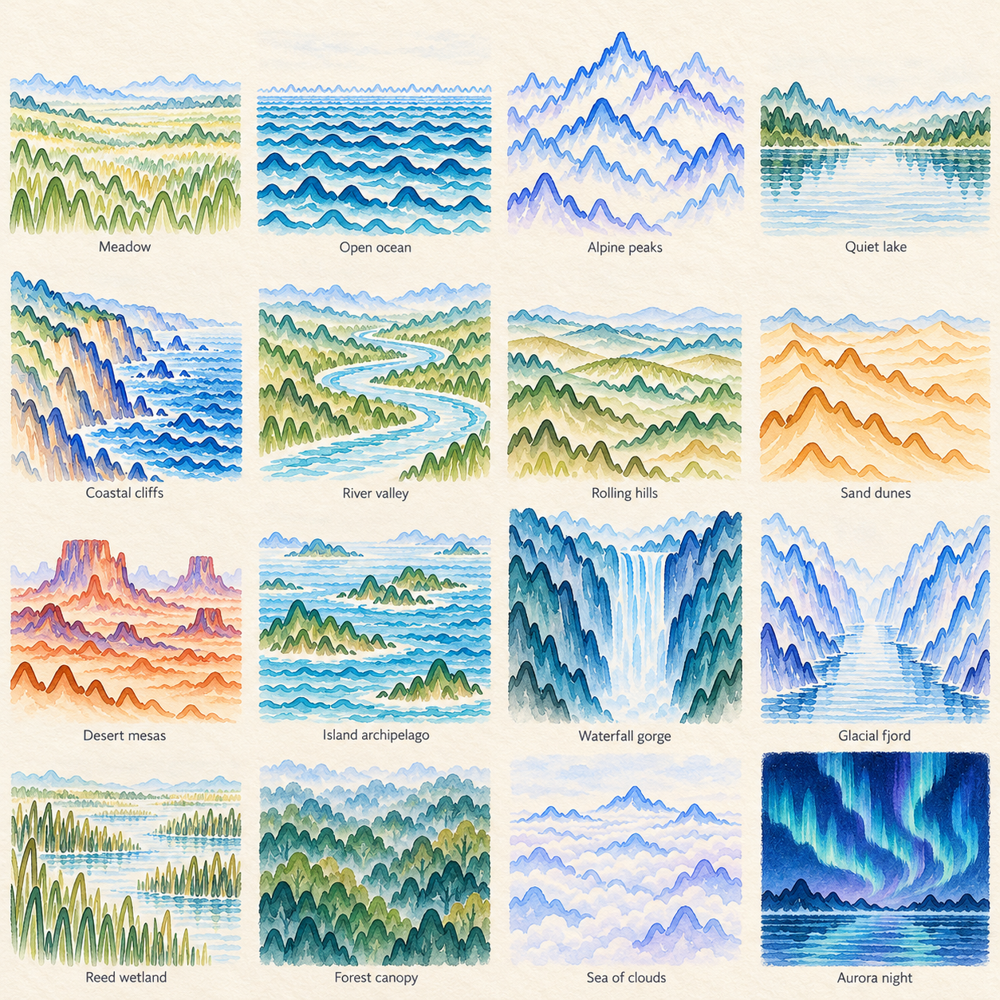
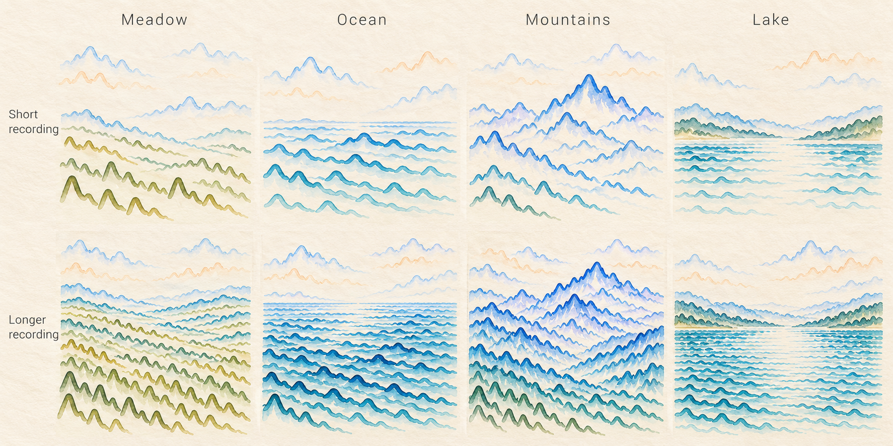

# Pulse Painting

Status: approved design direction for the next Pulse Painting experience. The
landscape renderer and continuous zoom-out are not implemented or deployed.
Repository extraction and the product rename are being handled separately. Pulse Painting remains a
project by ChatPPG. The user plans to register `pulsepainting.com`; ownership,
DNS configuration and a live deployment on that domain are not established here.

The generated previews in this brief explore composition, material and density.
They are illustrative, not derived from a user's recording. Some atlas scenes
still contain conventional filled forms or arcs; the images do not prove the
exact recorded-PPG geometry contract. That must be implemented and validated.

**Your pulse, made into a place.**

During recording, a close-up brush paints the session's accepted PPG waveforms
directly into a landscape. Completion reveals the same accumulated strokes with
one continuous zoom-out. From a distance it reads as a place; up close every
ridge, ripple, grass mark and cloud contour reveals a pulse trace. Keep the
original manuscript available in the menu alongside the landscape.

## Defining experience: paint close, reveal wide

1. **Choose the place at capture start.** Save the scene family, seed, palette,
   framing and version before recording begins. Prepare an invisible composition
   plan and reusable paint resources; this plan contains placement rules, not
   invented pulse marks. Do not show the complete scene before it has been painted.
2. **Stay close to the moving brush.** Present a macro view of the active stroke
   being laid into its actual position in the scene. Follow the brush with gentle,
   damped camera motion, showing pigment edges and paper texture. Use real accepted
   waveform geometry only. Analysis-window acceptance can introduce a visible
   delay; do not predict future beats or imply that the paint is an unfiltered
   live signal. While waiting or recovering, let the tip lift or rest without
   adding false pigment.
3. **Keep capture controls anchored.** The small finger-camera preview stays at
   the upper right, current pulse/RMSSD/SDNN remain legible, and the safe-area-aware
   bottom controls stay fixed while the artwork camera moves. Camera coaching and
   signal guidance remain available. The scene must not pull these elements along
   with its pan or zoom.
4. **Accumulate the final artwork throughout capture.** Store source-mapped stroke
   geometry and cache completed paint layers as accepted windows arrive. Let longer
   recordings fill additional, progressively closer slots between existing rows;
   already-painted strokes retain their positions. This makes more data visibly
   denser without secretly rearranging the finished scene. A lifted brush can travel
   between separated slots without drawing a connecting false waveform.
5. **Finish the stroke, then reveal.** Stop capture through the existing lifecycle,
   finish revealing the accepted portion of the current stroke, and lift the brush
   tip. Make an elegant approximately **3–4 second continuous zoom-out** from that
   exact location to the full composition. Use restrained depth between scene
   layers and smooth deceleration; do not swap in a different landscape at the end.
   Settle on the shareable artwork and bring the report controls into their final
   position. The original stroke geometry, color and placement remain the same.
6. **Export after the reveal is prepared.** Render a higher-resolution image from
   the same saved scene when needed. Export may refine raster resolution, not
   replace the composition. Prepare expensive work outside the moving reveal where
   possible, and retain a stable preview if export is still finishing.

Target approximately 60 fps on supported mobile devices by moving a lightweight
artwork camera over cached layers and updating only the active paint frontier.
Measurement, accepted-data storage and the protocol clock never depend on render
cadence or successful animation. Reduced motion uses a stationary view during
capture and an immediate full-scene reveal or short opacity fade, with no camera
travel, zoom or parallax. A slow device gets the same data-derived artwork through
a simpler presentation.

## Composition

Use sixteen art-directed families, listed below.
Choose the family with saved per-session seeded randomness, independently of the
recording's duration or density. A short recording can become mountains; a long
recording can become open ocean. Vary the horizon, viewpoint, landform placement,
bounded palette and detail within the chosen family's composition rules. Each
family retains a clear focal area, atmospheric depth and intentional paper space.
Use cobalt, iris and teal on warm paper, with color harmony shared across the
scene. Never associate a more attractive scene or a color with better health.
Scene names describe composition, not a person's physiology or personality.

| Element | Recorded geometry | Visual role |
| --- | --- | --- |
| Mountains | Longer waveform runs, scaled into broad overlapping ridge contours | Strongest silhouettes, middle distance |
| Water | Low-amplitude horizontal runs, with measured spacing retained inside each run | Quiet ripples and foreground depth |
| Grass | Short pulse sections positioned upright or diagonally | A few rich foreground accents |
| Sky | Widely spaced waveform runs with pale pigment | Clouds, air and negative space |

Treat these as artistic transforms, not an analysis plot. Retain the internal
timing and shape proportions of each trace within a bounded transform. Document
whether any reflected trace is reused; do not imply it is another measured beat.
The recorded asymmetry, rounded crest, decay and any present secondary shoulder
must remain recognizable. Do not add a dicrotic notch when the source lacks one.
Every scenery element must visibly derive from source traces: no conventional
trees, rocks, stars, reeds or other decorative objects may substitute for measured
geometry. Paper grain and pigment bloom are material treatments, not extra scene
objects or purported measurements.

### Sixteen scene families

Built-in image-generation concept atlas. Judge scene variety and atmosphere here;
do not treat the generated paths as real measurements or an exact rendering spec.
[Saved generation prompt](pulse-painting-scene-atlas.prompt.txt).

The sparse and dense treatments below are alternatives within the same family,
seed and framing. Density does not choose the family. Empty space is intentional
in every family; additional data fills planned contour slots without moving old
strokes or inventing marks.

| Family | Distinctive composition and pulse-stroke use | Short / sparse treatment | Longer / denser treatment |
| --- | --- | --- | --- |
| Meadow | Low horizon and a sweeping foreground; short upright or diagonal pulse runs read as grasses, with pale horizontal sky bands | A few separated grass-like runs and broad open paper | Closer interleaved foreground runs and additional pale sky layers, preserving a clear opening |
| Open ocean | Wide level horizon and a continuous water plane; shallow horizontal PPG rows create rolling water and distant cloud bands | Widely spaced water rows beneath a large sky | More ripple rows and layered swell bands, with light channels kept between them |
| Alpine peaks | Tall asymmetrical central mass and distant ranges; larger pulse runs stack into ridge contours | A few dominant ridges separated by generous paper | More intermediate ridges and nested slope rows, with the focal summit still distinct |
| Quiet lake | Low enclosing shore contours around a calm center; shallow pulse rows suggest water, with explicitly reused reflections if present | Open central water with a few shore and ripple runs | More shore contours and water rows while a quiet central corridor remains |
| Coastal cliffs | Strong stepped shoreline beside an open water plane; rotated pulse runs suggest cliff faces and shallow runs form the sea | A small set of cliff contours with broad sea spacing | Closely layered cliff runs and richer sea texture, retaining the land–water boundary |
| River valley | Two contour banks frame a winding negative-space channel; pulse runs articulate slopes and river surface | Spare banks and a few water runs around a broad clear channel | Additional bank contours and river rows, keeping the channel visually continuous |
| Rolling hills | Low overlapping horizontal bands across the page; long pulse runs form gentle ridge layers | A few generous bands with large gaps | More closely spaced intervening ridges and foreground texture without a solid ink mass |
| Sand dunes | Sweeping diagonal bands and strong paper highlights; pulse runs trace dune-like crests | Separated crests with broad unpainted slopes | Additional contour rows on selected slopes, preserving bright paper channels |
| Desert mesas | A few broad elevated groups with open gaps; stacked and rotated pulse runs suggest tiered landforms | Isolated contour groups with expansive surrounding paper | More internal tiers and ground rows, keeping each landform group separate |
| Island archipelago | Several separated contour clusters within broad water; nested pulse runs form islands and shallow rows form sea | A few small groups and widely spaced ripples | Additional contours within and between planned island groups, preserving navigable-looking open water |
| Waterfall gorge | A vertical focal cascade between opposing banks; rotated pulse runs form falling water and side contours form the gorge | A handful of falling-water runs within an open cleft | More neighboring cascade runs and bank layers, retaining a bright vertical passage |
| Glacial fjord | Tall opposing contour walls narrowing toward distance; pale horizontal water rows create a deep central inlet | Spare side contours and broad pale water | More wall layers and water rows, while the distant focal opening remains clear |
| Reed wetland | Low horizon with grouped upright or diagonal pulse segments across shallow water | A few separated reed-like groups and sparse water runs | More interleaved groups and water contours, preserving gaps between foreground clusters |
| Forest canopy | Overlapping rounded contour clusters seen across a canopy; curved or rotated pulse runs suggest foliage masses, without illustrated trees or trunks | A few floating contour groups with bright gaps | More nested pulse rows within planned canopy groups, maintaining channels of paper |
| Sea of clouds | High open viewpoint and low drifting contour banks; pale pulse rows gather into airy cloud layers | A few widely separated cloud bands | More nested cloud rows at restrained opacity, with ample open sky retained |
| Aurora night | A dark-indigo tonal family within warm-paper margins; long rotated pulse runs form luminous curtain-like bands, with no invented stars or moon | A few luminous separated bands and large quiet intervals | Additional curtain rows and measured secondary bands while the brightest contours remain readable |

## What the recording controls

- Ordered waveform shape selects ridge contours, ripple shapes and grass marks.
- Relative timing variation gently changes spacing and grouping within safe bounds.
- Accepted duration visibly controls distance between waveform rows, layer count
  and total painted coverage. More usable recording creates a denser scene; less
  creates a more spacious scene. It does not choose the landscape family.
- Signal confidence affects local pigment definition without making poor recordings
  muddy or unreadable. Rejected windows remain absent rather than becoming false traces.
- A per-session seed selects the landscape family and varies composition within
  beautiful bounds. This is a separate axis from recording density. Save the seed,
  algorithm version, palette and transforms at capture start so exporting the same
  session always reproduces its scene, while a new session receives a new
  interpretation. Recovery, resize, replay and export never reseed the scene.

Each accepted window must be represented. Store source time ranges with the scene
strokes and validate complete coverage. Do not select only attractive beats or
silently synthesize additional pulse shapes. Pigment spread and paper grain are
decorative material, separate from the source geometry.

Keep the source-coverage map, acceptance/quality mask, seed, renderer version and
transforms in the private scene descriptor used for replay and export. Preserve
the distinction between rejected source intervals and unpainted composition
space. These records and raw waveform values must not be embedded in public PNG,
JPEG or shared-image metadata; saving a shareable image is not consent to share
its underlying recording.

## Recording amount becomes visible density

Base density on usable captured duration and the accepted waveform runs, not raw
sample count: a higher camera frame rate must not make an otherwise identical
recording denser. Rejected windows, interruptions and duplicate samples do not add
paint. The actual pulse shapes and relative beat timing still come from the data.

Within every landscape family, increase detail through three coordinated changes:

1. Narrow the space between separate waveform rows as accepted duration grows.
2. Add contour layers across the sky, terrain and foreground areas that belong to
   that scene; do not force mountains or grass into an open-ocean composition.
3. Increase overall ink coverage within a bounded range, preserving open paper,
   a clear focal area and separation between readable individual pulses.

These are changes to placement between traces, not changes to the relative timing
or shape inside a trace. Do not normalize every recording to the same full page
of marks, repeat beats to fill a short recording, or discard extra accepted data
to keep a long recording at the sparse layout's density. Every accepted run must
still have a source-mapped place in the scene. When a band's spacing reaches its
readability limit, allocate further runs to other appropriate layers and validate
the complete scene at export resolution rather than continuing to overlap lines.

| Usable recording amount | Visual result in the same chosen family |
| --- | --- |
| Short | Fewer contour layers, broad spacing and deliberate paper space; a complete minimal composition |
| Intermediate | More layers, moderate spacing and richer foreground or water detail |
| Longer | Closely layered contours and greater coverage, while individual pulse shapes and the focal area remain clear |

This four-family, two-density board illustrates the two independent design axes.
It does not compare actual recordings or demonstrate accepted-data coverage.
[Saved generation prompt](pulse-landscapes-density-scenes.prompt.txt).

Treat density limits as art-direction bounds to validate over the supported
three-minute capture protocol. Short recordings should look intentionally spare,
not unfinished; longer ones should feel richer, not crowded. Signal quality may
reduce the amount of usable data, but the resulting sparse composition receives
the same attention and visual quality.

## Data-quality state contract

Use the existing engine's acceptance and quality validators. Do not introduce
medical-looking beat counts, amplitude cutoffs or new health scores to decide
whether someone deserves an artwork. “Enough for a full scene” describes accepted
recording amount and layout occupancy within the supported protocol, not a health
threshold. Density uses **accepted recorded time**, never raw sample count, elapsed
wall time, noise quantity or the number of rejected excursions.

| State | Visible result | Concrete acceptance test |
| --- | --- | --- |
| No accepted pulse | Keep the paper and clear placement/retry guidance. Do not show a fabricated personal landscape or enable sharing a nonexistent pulse artwork. | Replay a fixture with no accepted windows. Assert zero measured strokes, zero accepted-time density, no invented fallback pulse, and an actionable retry state. |
| A few valid runs | Reveal a finished sparse version of the selected scene, with wide spacing and intentional open paper. Keep the same seed/family; no padding or repeated filler beats. | Trim a valid fixture to one or a few accepted runs. Assert every run is source-mapped exactly, no extra original strokes appear, spacing is wider than the same scene's longer recording, and an early finish completes cleanly. |
| Enough accepted clean data | Build the fuller scene by filling additional planned contour slots, retaining readable pulses and the focal area. | Replay a clean full-protocol fixture. Assert complete accepted-time coverage, denser occupancy than its short prefix, bounded ink coverage, and no clipped contours or unreadable overlap. |
| Mixed accepted and rejected data | Paint accepted runs only. Rejected windows and gaps leave open space; their noise must not create dramatic terrain or increase density. | Replay a fixture containing known clipping, artifact and missing-data intervals. Assert every drawn original run belongs to accepted source ranges, the accepted-range union is complete, invalid ranges add no strokes/time, and no line bridges a gap. |
| Ongoing dropout or placement loss | Hold the last valid painted stroke, lift/rest the tip and show camera-placement/recovery guidance. Resume from fresh accepted data without false progress. | Interrupt camera frames during capture, then recover. Assert no added stroke or protocol-time credit during the interruption, unchanged seed/prior geometry, no duplicate run on recovery, and continued responsive controls. |

Artwork eligibility and metric eligibility are separate. A few accepted waveform
runs can make a small painting even when frequency-domain HRV, RMSSD or another
metric lacks its required evidence. Show each metric only when its own existing
validity/eligibility checks pass; otherwise show its existing unavailable reason.
Conversely, never create missing artwork geometry just because a summary metric
is available. Test both a short valid painting with withheld HRV details and a
mixed-quality session whose available metrics differ by analysis method.

Apply quality rejection before any display transform. Use bounded robust amplitude
scaling on accepted runs to keep low-amplitude traces legible and isolated extremes
from dominating the entire landscape. Fit an extreme accepted run by scaling or
placing the whole run within its allotted region, preserving its internal shape;
do not clip or replace individual peaks for aesthetic convenience. Test low-amplitude
and extreme-amplitude fixtures for finite geometry, bounded placement and unchanged
source attribution. Clipped/rejected samples must remain absent even if scaling
could make them look attractive. Poor signal is a capture condition, not poor
health; every eligible scene receives the same composition quality.

For every state, re-export with the saved private descriptor and compare scene
geometry, quality mask and coverage. Confirm that the public image contains none
of those private fields or raw values. A render/export failure must preserve the
accepted data and the last stable scene rather than silently reducing coverage.

## Beauty across data conditions

Regular traces produce calm, repeated contours; varied traces produce richer
terrain. Both receive the same composition quality. Bound scaling, contrast,
overlap and ink coverage instead of allowing raw extremes to set the layout.
Long recordings add visibly denser layers within the readability limits. A short
session becomes a minimal treatment of whichever scene its seed selected, without
being reassigned to a different family. Interrupted sessions retain breathing
room. With no accepted pulse, offer another capture rather than fabricate personal art.

Use objective layout checks (no clipping, bounded ink coverage, clear focal area,
complete accepted-data coverage, legible signature) alongside human review across
regular, irregular, sparse, low-amplitude and interrupted fixtures. Aesthetic
quality is a design goal to validate, not a guarantee derivable from one metric.

Review the two independent axes explicitly: a four-column board for meadow,
ocean, mountains and lake, with short/sparse and longer/denser rows. Hold the
family, seed and camera framing constant within each column so the density
difference is visible. Separately compare new seeds at the same accepted duration
to validate scene diversity without confusing it with data quantity. Use a separate
sixteen-scene atlas to judge silhouette diversity across the complete family set.

## Broad QA and fallback matrix

“All possible scenarios” is a request for broad, explicit coverage, not a claim
that a finite matrix proves every device or recording. Pair automated invariants
with human review of representative captures, still images and reveal motion.
Exercise the data cases across all sixteen families, sample scene seeds, and test
the interaction/device cases on each supported rendering path.

| Scenario | Required behavior and visible polish | Coverage / acceptance invariant |
| --- | --- | --- |
| No accepted data | Keep intentional warm paper and clear placement guidance; offer another capture rather than a personal landscape | Zero measured strokes; no seed-generated substitute beats or misleading artwork |
| Very short or early-finished recording | Present a complete minimal treatment of the already selected scene; finish the current accepted stroke and reveal without waiting for filler | Every accepted run represented; no repetition to fill space; partial duration is explicit |
| Partial and full three-minute recording | Increase planned slot occupancy, layer count and coverage gradually; sparse and dense outputs both retain a focal area | Complete accepted-run coverage, no clipping, and readable pulse shapes at the intended export/view sizes |
| Longer recording | Define supported duration, geometry and export bounds before capture/import; allocate additional legitimate layers within the budget, or explain an unsupported length before accepting it | Never silently drop, merge into invented beats, or crop excess data to force a fixed-density image |
| Multiple recordings or imports | Import only after explicit user action; declare which sessions are included, preserve their boundaries, and keep combined art distinguishable from one continuous capture | Each included run appears with its source identity; gaps are not connected; no automatic inclusion of prior sessions |
| Near-uniform pulse shapes or timing | Let ordered contours create a calm composition; use seeded placement and tonal hierarchy for interest | No artificial variability or extra crests added to make uniform data look more dramatic |
| Highly variable pulse shapes or timing | Use bounded per-run transforms, spacing and layer placement to keep richness legible | Within-run relative timing and geometry remain attributable to their source; no aesthetic health judgment |
| Very low accepted amplitude | Apply documented bounded display scaling and a minimum legible pigment treatment | No alteration to reported measurements; source amplitude is retained in provenance, and unavailable signal is not promoted to valid data |
| Outliers, clipping, rejected windows and gaps | Honor the existing acceptance rules; stop paint across missing/rejected spans and let paper remain visible | No scenic bridge across a missing interval; no selecting only attractive accepted beats or inventing replacements |
| Frame dropout or camera interruption | Lift/rest the tip, show concise recovery guidance, keep camera preview and controls available, then resume at the next valid source run | No stale-frame time credit, duplicated strokes, false connecting stroke or discarded prior art |
| Hidden page, lock/unlock and return | Suspend decorative rendering, follow the capture lifecycle, then restore the same scene and brush progress with a gentle return | Measurement eligibility follows fresh capture frames, never wall-clock animation time; seed and completed strokes remain unchanged |
| Cancel, restart, repeated taps or late camera permission | Stop active work promptly; keep the last stable frame during cleanup and clearly distinguish a restarted session | Late grants cannot resume canceled capture; one active session; a new session gets its own seed and source map |
| Cancel or interrupt the final reveal | Settle safely on the accumulated artwork or the user's requested next screen; avoid a frozen halfway camera view | No data loss, duplicate completion, or reseeding; controls remain responsive |
| Resize, orientation or small viewport | Refit the artwork camera smoothly, keep the active stroke in view, and preserve readable metrics/finger preview/floating controls with safe-area spacing | Scene coordinates and stroke geometry stay unchanged; no clipping or hit-target obstruction; no accidental rerender as a different scene |
| Slow GPU or sustained missed frames | Reduce raster resolution and decorative texture/depth first; simplify camera motion if needed while preserving a stable painted surface | Capture and accepted-data storage continue independently; no data thinning to meet a frame-rate target |
| WebGPU, WebGL2 and unavailable GPU | Use the available renderer with the same scene model; retain a lightweight Canvas2D presentation when GPU rendering is unavailable | Renderer changes do not change source geometry, scene seed, accepted coverage or report values |
| GPU context loss during paint or reveal | Retain/rebuild a lower-cost cached view from saved geometry; show an immediate stable full scene if continuing camera travel is unsafe | No blank permanently blocked screen, repeated beats, lost source runs or restart of measurement caused by decoration |
| Reduced motion at load or changed mid-session | Use a stationary capture view and an immediate reveal or short opacity fade; cancel camera travel cleanly | No required pan, zoom, parallax or delay before controls become available; artwork remains identical |
| Memory pressure or export-size limit | Keep the on-screen artwork; offer a clearly stated lower-resolution export when needed and release temporary buffers promptly | Preserve every stroke in the lower-resolution output; never truncate the timeline or silently label a partial render as complete |
| Export failure | Retain the stable scene and report; show a concise retry/download choice without rerunning capture | Same scene descriptor and source coverage on retry; no loss of the only available artwork |
| Native share unsupported | Offer a direct image download and concise platform-appropriate guidance | Exported image matches the preview's composition; metrics stay opt-in |
| Native share failed or canceled | Failure offers retry or download; user cancellation simply returns to the artwork without an alarming error | Do not record cancellation as successful delivery or regenerate a different image |
| Replay, seed and algorithm-version determinism | Rebuild from stored scene descriptor, source map and version; changes of renderer or export resolution keep the same composition | Same session reproduces its geometry/layout; different sessions vary through new saved seeds; a software upgrade never silently reinterprets a saved scene |
| Privacy and source provenance | Keep rendering local, keep metrics opt-in, and omit raw samples, session identifiers and source maps from public image metadata | No implicit import/upload of health data; art is not a biometric identity or health/personality classification |

Across the matrix, check the sum and union of source intervals against the
accepted recording, with any intentional reflected reuse explicitly marked.
Every accepted run must have an original scene placement; reused pigment paths
cannot stand in for missing source coverage. The reveal must preserve exactly
the strokes accumulated during capture. Record actual device/backend/frame-time
evidence for performance claims, and keep browser replay separate from physical
camera, flash, sharing and thermal validation.

## Reveal and share

The full scene already exists in accumulated form when capture finishes. Lift
the brush, pull continuously from macro view to the whole landscape over roughly
3–4 seconds, and settle without changing the recorded marks. Restrained layer
depth adds atmosphere, not a dramatic 3D fly-through. Use cached paint for the
reveal and render high-resolution export afterward from the same geometry.
Reduced motion receives an immediate reveal or short fade. No generative image
service is needed at capture time: the shipped renderer constructs marks locally
and directly from the session data.

Default export: portrait 4:5, warm paper, discreet “Made from my pulse · ChatPPG”
signature, no metrics. Offer optional metrics and the original full manuscript.
Keep raw waveform values and session identifiers out of public image metadata.
An optional “See the waves” interaction can highlight the measured traces inside
the composition.

## Goal prompt

Create a distinctive, gallery-quality watercolor landscape using every accepted
PPG waveform from one recording as its source geometry. Mountains, water, grass
and sky must all be formed from the user's pulse traces. Preserve the organic
cobalt–iris–teal identity of Pulse Painting, use confident pigmented edges and
generous warm-paper space. Choose one of sixteen art-directed scene families at
capture start using saved per-session seeded randomness, independently of recording
duration. Show a macro view of a brush painting real accepted pulse strokes into
their final scene positions throughout recording. Follow the active stroke
smoothly while the finger preview, live metrics and floating controls remain
anchored. Let the data supply every stroke's shape and relative timing. Make
usable recording amount visibly control row spacing, contour-layer count and
painted coverage: short recordings are spacious and intentionally minimal;
longer recordings are denser and richer while individual pulses remain readable.
Represent every accepted waveform without invented or filler beats. Bound layout,
contrast and overlap so regular, variable, short and interrupted recordings all
receive an intentional composition. Follow the existing signal-quality validators:
no accepted data means honest retry, a few valid runs mean a finished sparse scene,
and rejected data adds neither paint nor density. Keep artwork and HRV eligibility
separate, and preserve source coverage and quality masks privately. At completion
finish the accepted stroke,
lift the brush, and use a restrained approximately 3–4 second continuous zoom-out
to reveal the same accumulated landscape. Plan and cache locally before and
during capture; render high-resolution export afterward. Target approximately
60 fps where supported, keep measurement independent of rendering, respect
reduced motion, and preserve a polished fallback across the documented data,
camera, renderer and sharing cases. Produce a shareable image that is stable when
re-exported and varied across new sessions.
Do not infer health or personality, invent missing pulse data, or present a
concept illustration as an actual data-derived result.

## Earlier material study

[Single-landscape watercolor study](pulse-landscapes-concept.png): an earlier
generated mood reference for pigment edges, paper and atmospheric depth. It has
the same illustrative-only limits as the atlas and density comparison.

## Biometric art direction

See [biometric scene mapping](biometric-scene-mapping.md) for the approved
visual mappings, evidence limits, and validity gates. These are product design
requirements, not a claim that the current app already implements them.
